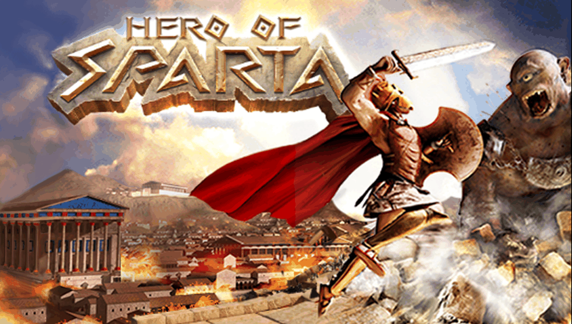

<h1 align="center">
  <br>
  Hero of Sparta · PS Vita Port
</h1>

<p align="center">
  <b>Native port of Hero of Sparta HD (Gameloft) for PlayStation Vita and PlayStation TV.</b>
</p>

<p align="center">
  
  
  
  
  
  
</p>

<p align="center">
  <a href="#-description">Description</a> •
  <a href="#-features">Features</a> •
  <a href="#-controls">Controls</a> •
  <a href="#-installation">Installation</a> •
  <a href="#-known-issues">Known Issues</a> •
  <a href="#-building-from-source">Build</a> •
  <a href="#-credits">Credits</a>
</p>

---

## 📖 Description

**Hero of Sparta** is Gameloft's mythological hack-and-slash action game, originally released for Android as
`Hero Of Sparta HD Free_1.1.4.apk` (package `com.gameloft.android.GAND.GloftSPAW.ML`). This port runs the compiled native
library (`libheroofsparta.so`, armeabi) from the Android release directly on the PS Vita's ARM Cortex-A9 processor, using a
dynamic loader (*soloader*) and an Android environment emulation layer (*FalsoJNI*), with
[vitaGL](https://github.com/Rinnegatamante/vitaGL) providing the GLES 1.x fixed-function rendering backend.

The engine belongs to the Gameloft 2012 family: same JNI natives (`GLMediaPlayer` / `GLResLoader` / `Device` /
`GameRenderer` / game natives) and the same companion `libStormGLOFT.so` as the Dungeon Hunter 2 port, whose proven loader
patterns this port reuses (FalsoJNI tables, SceAudioOut mixer thread, multi-root asset lookup). See
[`PORTING_PLAN.md`](PORTING_PLAN.md) for the full engine-detection write-up.

### ✨ What Works

- **Native ARM execution**: `libheroofsparta.so` (armeabi, 2503 exports, the 18 `Java_*` natives, no `JNI_OnLoad`) runs
  directly on the Vita's CPU via the soloader, with no interpretation or emulation of game code. `libStormGLOFT.so` is
  intentionally **not** loaded: it has no JNI exports and its `JNI_OnLoad` only installs an inline anti-tamper hook over
  `glTexImage2D` / `glViewport` / `glScissor` / `glGetError`.
- **Full JNI lifecycle bootstrap**, in the same order as the Android `GameRenderer.onSurfaceCreated` (`nativeGetJNIEnv` →
  `GLMediaPlayer.nativeInit` → `GLResLoader.nativeInit` → `HeroOfSparta.nativeInit(0)` → `GameRenderer.nativeInit(1,1280,752)`
  → `nativeResize`), then a continuous `GameRenderer.nativeRender()` loop with `audio_update_sound()` per frame, like `onDrawFrame`.
- **vitaGL fixed-function pipeline**: GLES 1.x (`libGLESv1_CM`) through a natively built vitaGL. The engine works internally at
  1280x752 and is presented on the Vita's 960x544 screen. All 121 undefined symbols are resolved in `source/dynlib.c`, plus a
  `PVRTCDecompress` hook.
- **Audio**: the engine's `GLMediaPlayer` bridge is real: 96 sounds and 16 musics (Ogg Vorbis from `hos/`, decoded at load time
  with `stb_vorbis`), mixed on its own thread to `sceAudioOut` (44.1 kHz stereo), with the same state machine as
  `GLMediaPlayer.java`. The intro video (`intro.vdo`) is skipped (`IsVedioFinished` → 1).
- **Assets from `ux0:`**: everything outside `.sav` / `.dat` goes through JNI to `GLResLoader` (`getResourceFull` /
  `getResourceBytes` / `getResourceLength`), served by a multi-root search (`res/drawable*`, `assets/`, `hos/`, direct path)
  with a miss log. Saves (`Setting.dat`, `Spartan*.dat`) go through direct `fopen`.
- **Saves**: `/mnt/sdcard/gameloft/games/hos/` → `hos/` and `/data/data/<pkg>/` → `saves/` are remapped to
  `ux0:data/heroofsparta/`, so progress persists across reboots.
- **Diagnostics**: per-boot log (`heroofsparta_NNN.log`), live HUD touch-zone dump (`[hud] nivel N zona M ...`), and a watchdog
  thread that forces a controlled crash with real thread stacks if a `nativeRender` makes no progress for 60 s.

## 🎮 Status & Playability

**Status: Playable (v1.0)**

The game boots through the menus and plays **in-game** (menu and gameplay confirmed on real hardware). See
[`port_progress.md`](port_progress.md) for the full bug-by-bug history. Every fix is backed by a real console log.

- [x] **Boot and menus**: confirmed on real hardware. *Verified on console.*
- [x] **Gameplay**: in-game, with the engine's own touch controls. *Verified on console.*
- [x] **Saves**: reads and correct writes of `Spartan.dat` / `Setting.dat` confirmed in a console log (`logs/heroofsparta_011.log`).
  *Verified on console.*
- [ ] **Physical buttons**: the only tracked open issue, work in progress (see Known Issues).

### 🛠️ Verified Saves (v1.0)

- Android paths are remapped: `/data/data/<package>/*.dat` → `saves/` inside `ux0:data/heroofsparta/`. The `saves/` folder is
  created automatically at boot.
- Confirmed with a real console log (`logs/heroofsparta_011.log`): reads of `Spartan.dat` / `Setting.dat` at boot and
  **correct writes** (`Spartan0.dat`, `Spartan.dat` opened `wb`, `fopen` OK + `fclose` OK, no errors). Progress persists across
  sessions.
- If a save ever failed, the Debug log would show it as `fopen(...): (nil)`; no such case to date.

### ⚡ Performance (v1.0)

- The game is locked to **30 FPS** (the engine advances its logic per frame; uncapped it would run fast-forward). Menu at 60,
  in-game stable at 30; very busy scenes (~500 draws/frame) can dip to ~22 FPS.
- PVRTC textures are uploaded **natively to the GPU** (no software decoding).
- Vita clocks at maximum from boot (ARM 444 / BUS 222 / GPU 222).
- Audio (96 SFX + 16 music tracks) is preloaded and decoded off the main thread; music streams.
- The Release build produces no per-frame logging: the eboot contains zero debug strings (`l_debug` / `l_info` / `l_warn` compile
  to nothing). Play with the Release VPK; the Debug build is for diagnostics only.

---

## ✨ Features

| Feature | Status | Notes |
| :--- | :---: | :--- |
| Boots to gameplay | ✅ | Menus and in-game confirmed on real hardware. |
| Graphics / renderer | ✅ | GLES 1.x on vitaGL. Internal 1280x752, presented on 960x544. PVRTC native. |
| Audio & music | 🟡 | 96 SFX and 16 music tracks via `sceAudioOut`. No separate console audio log is recorded in the notes. |
| Video / cutscenes | 🟡 | The intro (`intro.vdo`) is skipped by design. |
| Physical buttons | 🟡 | Pad injects synthetic touches onto the HUD zones. Work in progress (the only tracked issue). |
| Analog sticks / camera | 🧪 | Sticks and D-Pad drag the virtual joystick (`Main::ProcessJoystick`). Not separately verified. |
| Touch screen | ✅ | Original touch controls, 1:1 multitouch. |
| Button remapping / port menu | ❌ | Not implemented. START + SELECT quits to the LiveArea. |
| Save data | ✅ | Reads and writes confirmed in a console log (`heroofsparta_011.log`). |
| Native trophies | ❌ | Not implemented. |
| Languages | 🧪 | Not documented in the port notes. Not tested yet. |
| Performance | 🟡 | Locked at 30 FPS in-game, 60 in menus; busy scenes ~22 FPS (as stated in the v1.0 release notes). |
| Online / IAP / ads | 🧪 | Not documented in the port notes. <!-- TODO: confirm. --> |
| PS TV | 🧪 | Not tested yet. |

Legend: `✅ Working (verified on console) · 🧪 Implemented, not yet verified on console · 🟡 Partial · ❌ Not working · ➖ Not applicable · ❔ Not documented yet`

---

## 🎯 Controls

Physical buttons drive the engine's own HUD touch zones, read live from the GUI (no hardcoded coordinates: the pad taps wherever
the engine's buttons actually are).

| Vita input | Action |
|---|---|
| Left stick / Right stick / D-Pad | Drag the virtual joystick (through `Main::ProcessJoystick`) |
| Cross | Sword attack (HUD zone 6); closes the dialog box (its ✕) when one is open |
| Circle | Shield (HUD zone 4) |
| Triangle | Focused kill (HUD zone 2, `ShowFatalityButton`) |
| Start | Android MENU key (pause) |
| **START + SELECT** | **Quit to LiveArea** |
| Front touch | Original touch controls, 1:1 multitouch (one pointer per finger, down/move/up in the engine's 1280x752 space) |

---

## 📋 Prerequisites

To run this port on your PS Vita or PS TV, you will need:

1. A PS Vita / PS TV on Custom Firmware (**HENkaku** / **h-encore** / **Enso**), 3.60-3.74.
2. [**kubridge**](https://github.com/TheOfficialFloW/kubridge/releases) and [**FdFix**](https://github.com/TheOfficialFloW/FdFix/releases)
   installed as kernel plugins (`ur0:tai/config.txt` under `*KERNEL`).
3. [**libshacccg.suprx**](https://github.com/Rinnegatamante/ShaRKBR33D/releases/latest) installed in `ur0:data/`
   ([extraction guide](https://samilops2.gitbook.io/vita-troubleshooting-guide/shader-compiler/extract-libshacccg.suprx)).
4. A legally obtained copy of **Hero of Sparta HD Free v1.1.4** (`Hero Of Sparta HD Free_1.1.4.apk`) **and** its downloaded game
   data folder (`/mnt/sdcard/gameloft/games/hos/` from an Android device where the game was installed and run once).
   You provide these files yourself; they are not included in the repository.

---

## 📦 Installation

1. Install `heroofsparta.vpk` on your console with **VitaShell**.
2. Extract `Hero Of Sparta HD Free_1.1.4.apk` on your PC with any zip extractor.
3. Copy to `ux0:data/heroofsparta/`:
   - `lib/armeabi/libheroofsparta.so` from the APK → `ux0:data/heroofsparta/libheroofsparta.so`
   - `assets/data.save` from the APK → `ux0:data/heroofsparta/assets/data.save`
   - `res/*` from the APK → `ux0:data/heroofsparta/res/` (`drawable*/`, `layout/`, `raw/`, ...)
   - the whole Android data folder `hos/` → `ux0:data/heroofsparta/hos/` (`*.ogg` music/sfx, game pack, ...)
4. Launch **Hero of Sparta** from the LiveArea. The first load takes a few minutes (texture decompression); later loads are faster.

### Final file structure in `ux0:data/heroofsparta/`

```text
ux0:data/heroofsparta/
├── libheroofsparta.so       <- lib/armeabi/ from the APK
├── hos/                     <- Android data folder, as-is (~122 MB: *.ogg, game data)
├── res/                     <- res/ from the APK (drawable*/, layout/, raw/, ...)
├── assets/
│   └── data.save            <- assets/ from the APK
├── saves/                   <- created by the game (Setting.dat, Spartan*.dat)
└── logs/                    <- one heroofsparta_NNN.log per boot (Debug builds only, per the v1.0 release notes)
```

`libStormGLOFT.so` is **not** needed.

---

## 🐛 Known Issues

> **Note:** the **physical-buttons issue below is currently the only tracked issue**, and it is being actively worked on.
> There are no other open issues for v1.0.

- **Physical buttons (only tracked issue, WIP)**: the pad injects synthetic touches onto the HUD touch zones, read live from the
  engine (no hardcoded coordinates). If a button ever seems to miss, the Debug log (`pad -> toque ... en nivel ... zona ...`)
  shows exactly where the synthetic tap landed.
- **Intro video**: `intro.vdo` is skipped instead of played. If the engine ever blocks on it, the log will show it.
- **HUD opacity**: the virtual HUD controls are drawn at full opacity (there is no faded-controls mode: the physical pad already
  drives them through the live touch zones, and touch still works on top).
- **First load**: the first load takes a few minutes (texture decompression).

---

## 🔨 Building from Source

This port does **not** keep a local copy of `porting_tools/`: build, deploy, logs, LiveArea and crash-dump workflows are handled
by **psvita-port-toolkit**, a standalone tool kept outside this repository (open it and pick *"Continuar con un port existente"*
pointing at this folder).

### Build Prerequisites

- **VitaSDK** (softfp).
- vitaGL is vendored in `lib/vitagl` and built automatically with the project's make flags.
- CMake and Make (or Ninja).

### Build Steps

```bash
git submodule update --init
cmake -B build -DCMAKE_BUILD_TYPE=Release
cmake --build build
```

This produces `build/heroofsparta.vpk` (about 1.1 MB, containing the Release eboot and LiveArea). A `Debug` build keeps the full
loader log in `ux0:data/heroofsparta/logs/`. For day-to-day development use `psvita-toolkit build` / `deploy`.

---

## 📁 Project Structure

- `source/main.c`: lifecycle, render loop, input mapping (sticks / D-Pad → joystick drag, buttons → synthetic touches on live GUI
  zones, multitouch front panel).
- `source/patch.c`: `PVRTCDecompress` hook and live GUI touch-zone reader (`hud_area_center` / `hud_dump_areas` via
  `GUILevel::GetParamValue`).
- `source/java.c`: 55 registered JNI methods: the 22 `GLMediaPlayer` methods the `.so` looks up, plus the 3 `GLResLoader` asset
  methods with multi-root search.
- `source/audio.c/h`: `GLMediaPlayer` bridge (stb_vorbis decode-on-load, SceAudioOut mixer thread, `updateSound` voice cleanup).
- `source/dynlib.c`: GLES1 / libc symbol wrappers (121 of 121 undefined symbols covered).
- `source/reimpl/io.c`: path remapping (`/mnt/sdcard/...` → `DATA_PATH`, `/data/data/...` → `saves/`).
- `lib/`: `so_util`, `falso_jni`, `stb_vorbis`, vendored `vitagl`.
- `extras/`: LiveArea assets, `cpuinfo` / `meminfo`, scripts.
- `PORTING_PLAN.md`: living plan: engine findings, JNI table, data layout.
- `port_progress.md`: bug-by-bug diagnosis log, one confirmed bug at a time.
- `RELEASE_v1.0.md`: release notes for v1.0.

---

## 📜 Disclaimer

**Hero of Sparta** and **Gameloft** are registered trademarks of Gameloft. The work presented in this repository is not "official"
or produced or sanctioned by Gameloft or any other registered trademark mentioned in this repository.

This software does not contain the original code, executables, assets, or other non-redistributable parts of the original game
product. The authors of this work do not promote or condone piracy in any way. To launch and play the game on their PS Vita
device, users must possess their own legally obtained copy of the game in the form of an `.apk` file and its data.

---

## ☕ Support My Work

This project is **free** and will stay free. If you enjoy it, a tip from **$1** helps me keep porting games to the PS Vita:

<p align="center">
  <a href="https://ko-fi.com/metalsyntax"></a>
</p>

- **Ko-fi:** [ko-fi.com/metalsyntax](https://ko-fi.com/metalsyntax)
- **PayPal:** [paypal.me/MetalSyntax](https://paypal.me/MetalSyntax)
- **Bitcoin (BTC):** `133HdCsaWxdjTfmwpgGVykByhNBV338uRc`

**Ko-fi supporters get:**
- **Early access** to new ports before their public release (test builds of upcoming projects).
- **Data preparation scripts and step-by-step guides** to set up your own game files for each new port.
- A say in which games I port next.

> Game files are never distributed. You always need your own legally obtained copy of the game.

---

## 👥 Credits

- **Gameloft**: original developers of Hero of Sparta.
- **TheFloW**: `so_util`, `kubridge`, `FdFix`, and the foundational techniques for loading Android executables on PS Vita.
- **Rinnegatamante**: `vitaGL` and continued support to the PS Vita porting scene.
- **v-atamanenko**: `FalsoJNI` and the `soloader-boilerplate` base template.
- **Vita Community**: all developers and enthusiasts in the PS Vita homebrew community.

---

## 📄 License

This software may be modified and distributed under the terms of the MIT license. See the [LICENSE](LICENSE) file for details.
